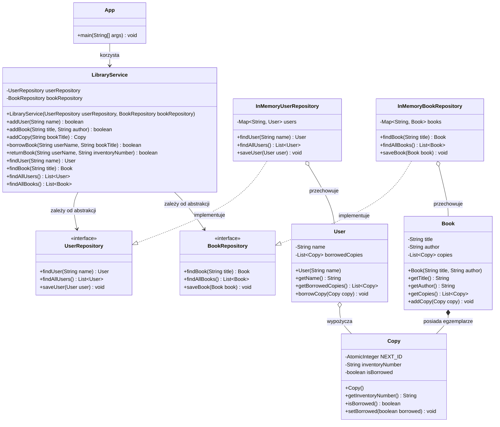

# Dokumentacja systemu biblioteki

## Diagram klas

## Diagram przypadków użycia

## Scenariusze przypadków użycia

### UC1 — Dodaj czytelnika

**Aktor:** czytelnik lub pracownik biblioteki.

**Warunki początkowe:**
- system jest uruchomiony i wyświetla menu główne;
- użytkownik wybiera opcję `1`.

**Scenariusz główny:**

1. Aktor podaje nazwę czytelnika.
2. System wywołuje metodę `addUser(name)` z klasy `LibraryService`.
3. `LibraryService` sprawdza, czy czytelnik o tej nazwie już istnieje.
4. Jeśli nie istnieje, system zapisuje nowego użytkownika i wyświetla komunikat o pomyślnym dodaniu.

**Warunki końcowe:**
- w repozytorium pojawia się nowy użytkownik;
- jeśli użytkownik o takiej nazwie już istnieje, operacja nie tworzy duplikatu.

**Wyjątki:**
- jeżeli nazwa już występuje w systemie, metoda `addUser` zwraca `false`, a aplikacja wyświetla komunikat: „Czytelnik o takiej nazwie już istnieje.”

### UC2 — Dodaj książkę

**Aktor:** pracownik biblioteki.

**Warunki początkowe:**
- system jest uruchomiony;
- użytkownik wybiera opcję `2`.

**Scenariusz główny:**

1. Aktor podaje tytuł i autora książki.
2. System wywołuje metodę `addBook(title, author)`.
3. `LibraryService` sprawdza, czy książka o takim tytuł już istnieje.
4. Jeśli nie istnieje, zapisuje nową książkę i wyświetla komunikat o dodaniu.

**Warunki końcowe:**
- w repozytorium pojawia się nowa książka;
- tytuł książki jest unikalny w systemie.

**Wyjątki:**
- jeżeli książka o tym tytule już istnieje, metoda `addBook` zwraca `false`, a aplikacja wyświetla komunikat: „Książka o tym tytule już jest w systemie.”

### UC3 — Dodaj egzemplarz książki

**Aktor:** pracownik biblioteki.

**Warunki początkowe:**
- system jest uruchomiony;
- użytkownik wybiera opcję `3`;
- książka, do której ma zostać dodany egzemplarz, musi już istnieć w systemie.

**Scenariusz główny:**

1. Aktor podaje tytuł książki.
2. System wywołuje metodę `addCopy(bookTitle)`.
3. `LibraryService` wyszukuje książkę po tytule.
4. Jeżeli książka istnieje, system tworzy nowy obiekt `Copy` i dodaje go do książki.
5. Program wyświetla numer inwentarzowy nowego egzemplarza.

**Warunki końcowe:**
- do książki zostaje dodany nowy egzemplarz;
- nowy egzemplarz ma unikalny numer inwentarzowy.

**Wyjątki:**
- jeżeli książka nie istnieje, metoda `addCopy` zwraca `null`, a aplikacja wyświetla komunikat: „Nie znaleziono takiej książki. Najpierw ją dodaj (Opcja 2).”

### UC4 — Wypożycz książkę

**Aktor:** czytelnik.

**Warunki początkowe:**
- system jest uruchomiony;
- użytkownik wybiera opcję `4`;
- użytkownik i książka są podawane ręcznie przez użytkownika.

**Scenariusz główny:**

1. Aktor podaje nazwę czytelnika i tytuł książki.
2. System wywołuje metodę `borrowBook(userName, bookTitle)`.
3. `LibraryService` szuka czytelnika i książkę w repozytorium.
4. Jeśli oba obiekty istnieją, system przegląda egzemplarze książki i wybiera pierwszy dostępny.
5. Egzemplarz zostaje dodany do listy wypożyczonych przez czytelnika i oznaczony jako „wypożyczony”.
6. Metoda zwraca `true`, a aplikacja wyświetla komunikat o pomyślnym wypożyczeniu.

**Warunki końcowe:**
- czytelnik ma wypożyczony egzemplarz;
- egzemplarz ma status `isBorrowed == true`.

**Wyjątki:**
- jeżeli czytelnik lub książka nie istnieją, metoda `borrowBook` zwraca `false`, a aplikacja wyświetla komunikat: „Błąd: Nie znaleziono czytelnika lub książki w systemie.”
- jeśli książka nie ma dostępnych egzemplarzy, metoda również zwraca `false` i kończy operację.

### UC5 — Zwróć książkę

**Aktor:** czytelnik.

**Warunki początkowe:**
- system jest uruchomiony;
- użytkownik wybiera opcję `5`;
- użytkownik musi istnieć w systemie.

**Scenariusz główny:**

1. Aktor podaje nazwę czytelnika.
2. System sprawdza, czy użytkownik istnieje.
3. Jeżeli użytkownik istnieje, aktor podaje numer inwentarzowy zwracanego egzemplarza.
4. System wywołuje metodę `returnBook(userName, inventoryNumber)`.
5. `LibraryService` szuka egzemplarza na liście wypożyczonych przez użytkownika.
6. Jeśli egzemplarz zostanie znaleziony, zostaje usunięty z listy wypożyczonych i oznaczony jako dostępny.
7. Aplikacja wyświetla komunikat o zwrocie.

**Warunki końcowe:**
- egzemplarz przestaje być przypisany do użytkownika;
- egzemplarz ma status dostępny do kolejnego wypożyczenia.

**Wyjątki:**
- jeżeli użytkownik nie istnieje, aplikacja wyświetla komunikat: „Nie znaleziono czytelnika.”
- jeżeli użytkownik nie ma egzemplarza z podanym numerem inwentarzowym, aplikacja wyświetla komunikat: „Czytelnik nie posiada egzemplarza o takim numerze.”

### UC6 — Wyświetl listę czytelników

**Aktor:** czytelnik lub pracownik biblioteki.

**Warunki początkowe:**
- system jest uruchomiony;
- użytkownik wybiera opcję `6`.

**Scenariusz główny:**

1. System wywołuje `findAllUsers()`.
2. Jeśli lista użytkowników jest pusta, wyświetla komunikat o braku użytkowników.
3. W przeciwnym razie wyświetla imiona czytelników oraz liczbę wypożyczonych egzemplarzy.

**Warunki końcowe:**
- użytkownik widzi aktualną listę wszystkich czytelników w systemie;
- dla każdego czytelnika wyświetlana jest liczba jego wypożyczonych książek.

**Wyjątki:**
- jeżeli nie ma żadnych użytkowników, aplikacja wyświetla komunikat: „Brak użytkowników w systemie.”

### UC7 — Wyświetl listę książek

**Aktor:** czytelnik lub pracownik biblioteki.

**Warunki początkowe:**
- system jest uruchomiony;
- użytkownik wybiera opcję `7`.

**Scenariusz główny:**

1. System wywołuje `findAllBooks()`.
2. Jeśli lista książek jest pusta, wyświetla komunikat o braku książek.
3. W przeciwnym razie wyświetla listę książek wraz z autorami oraz stanem każdego egzemplarza.

**Warunki końcowe:**
- użytkownik widzi wszystkie książki w systemie oraz status każdego egzemplarza;
- stan każdej kopii jest odczytywany bezpośrednio z obiektu `Copy`.

**Wyjątki:**
- jeżeli nie ma książek, aplikacja wyświetla komunikat: „Brak książek w systemie.”
- jeżeli książka nie ma żadnych egzemplarzy, wyświetla komunikat: „Brak egzemplarzy.”

### UC8 — Zakończ pracę systemu

**Aktor:** czytelnik lub pracownik biblioteki.

**Warunki początkowe:**
- system jest uruchomiony;
- użytkownik wybiera opcję `0`.

**Scenariusz główny:**

1. Aktor wybiera `0` z menu.
2. System ustawia zmienną `running` na `false`.
3. Aplikacja wyświetla komunikat „Zamykanie systemu...” i kończy działanie.
4. `Scanner` zostaje zamknięty.

**Warunki końcowe:**
- aplikacja kończy działanie;
- program nie wykonuje żadnych dalszych instrukcji.

**Wyjątki:**
- w typowym przebiegu działania aplikacji brak wyjątków; zamknięcie następuje poprawnie po wybraniu opcji `0`.

