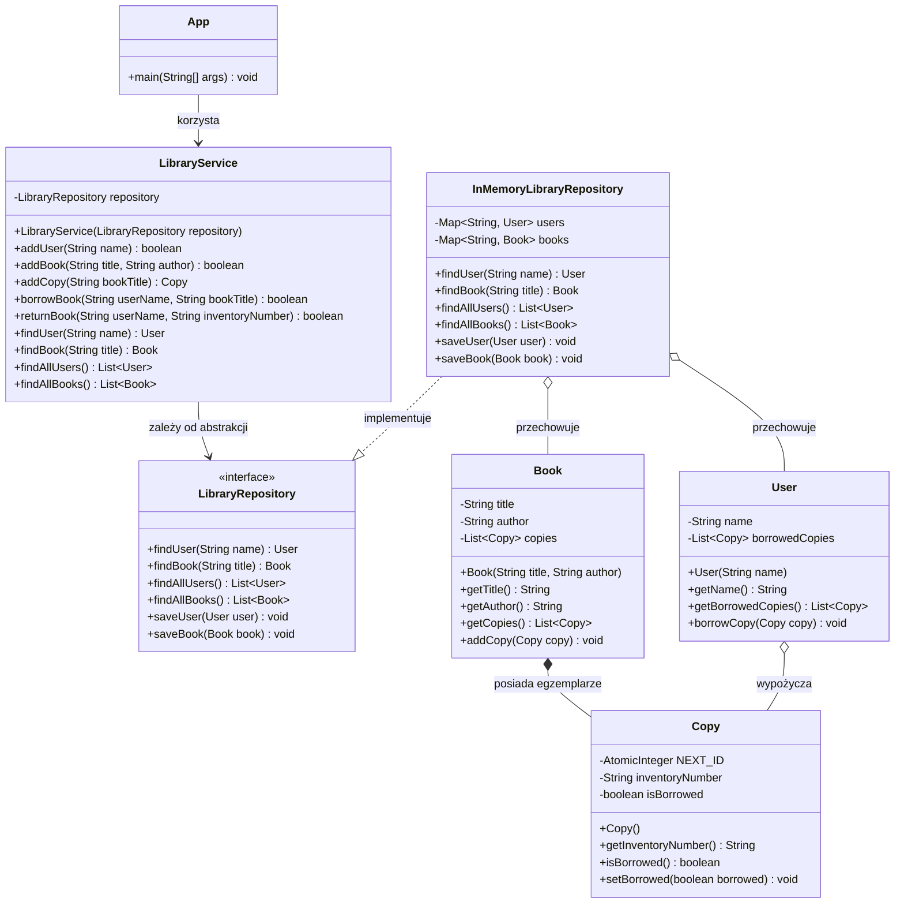
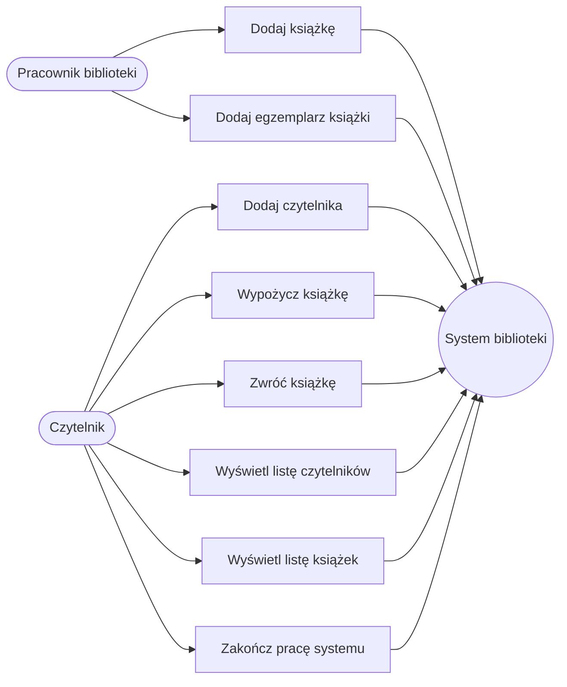

# Dokumentacja systemu biblioteki

## Diagram klas

## Diagram przypadków użycia

## Scenariusze przypadków użycia

### UC1 — Dodaj czytelnika

**Aktor:** czytelnik lub pracownik biblioteki.

**Warunki początkowe:** system działa i wyświetla menu.

**Scenariusz główny:**

1. Aktor wybiera opcję `1`.
2. System prosi o nazwę czytelnika.
3. Aktor podaje nazwę.
4. `LibraryService` sprawdza, czy taka nazwa nie istnieje w repozytorium.
5. System tworzy obiekt `User`, zapisuje go i wyświetla potwierdzenie.

**Scenariusz alternatywny:** jeżeli nazwa już istnieje, system nie tworzy
drugiego obiektu i wyświetla komunikat o istniejącym czytelniku.

**Warunek końcowy:** nowy czytelnik znajduje się w repozytorium albo dane
pozostają bez zmian.

### UC2 — Dodaj książkę

**Aktor:** pracownik biblioteki.

**Warunki początkowe:** system działa i wyświetla menu.

**Scenariusz główny:**

1. Aktor wybiera opcję `2`.
2. System prosi o tytuł książki.
3. Aktor podaje tytuł i autora.
4. `LibraryService` sprawdza, czy tytuł nie jest już zapisany.
5. System tworzy obiekt `Book`, zapisuje go i wyświetla potwierdzenie.

**Scenariusz alternatywny:** jeżeli tytuł już istnieje, system odrzuca
operację, niezależnie od podanego autora.

**Warunek końcowy:** w systemie istnieje najwyżej jedna książka o danym
tytule.

### UC3 — Dodaj egzemplarz książki

**Aktor:** pracownik biblioteki.

**Warunki początkowe:** książka może, ale nie musi, istnieć.

**Scenariusz główny:**

1. Aktor wybiera opcję `3`.
2. Podaje tytuł książki.
3. `LibraryService` wyszukuje książkę.
4. System tworzy `Copy` z kolejnym numerem inwentarzowym, na przykład `C001`.
5. Egzemplarz zostaje dodany do listy kopii książki.
6. System wyświetla numer inwentarzowy.

**Scenariusz alternatywny:** jeżeli książka nie istnieje, system nie tworzy
egzemplarza i informuje, że najpierw trzeba dodać książkę.

**Warunek końcowy:** istniejąca książka ma jeden dodatkowy, dostępny
egzemplarz albo dane pozostają bez zmian.

### UC4 — Wypożycz książkę

**Aktor:** czytelnik.

**Warunki początkowe:** czytelnik, książka i co najmniej jeden egzemplarz
mogący zostać wypożyczonym istnieją w systemie.

**Scenariusz główny:**

1. Aktor wybiera opcję `4`.
2. Podaje nazwę czytelnika i tytuł książki.
3. System wyszukuje użytkownika i książkę.
4. `LibraryService` przechodzi po egzemplarzach książki.
5. Pierwszy dostępny egzemplarz zostaje dodany do wypożyczeń użytkownika.
6. Egzemplarz otrzymuje status „wypożyczony”.
7. System wyświetla potwierdzenie.

**Scenariusze alternatywne:**

- jeżeli użytkownik lub książka nie istnieją, system odrzuca operację;
- jeżeli wszystkie egzemplarze są wypożyczone, system odrzuca operację;
- w obu przypadkach system wyświetla komunikat o błędzie.

**Warunek końcowy:** przy sukcesie użytkownik posiada egzemplarz na liście
wypożyczeń, a egzemplarz ma status „wypożyczony”.

### UC5 — Zwróć książkę

**Aktor:** czytelnik.

**Warunki początkowe:** użytkownik istnieje i posiada wypożyczony egzemplarz.

**Scenariusz główny:**

1. Aktor wybiera opcję `5`.
2. Podaje nazwę użytkownika.
3. System sprawdza, czy użytkownik istnieje.
4. Aktor podaje numer inwentarzowy egzemplarza.
5. `LibraryService` szuka egzemplarza w wypożyczeniach użytkownika.
6. System usuwa egzemplarz z wypożyczeń i oznacza go jako dostępny.
7. System wyświetla potwierdzenie.

**Scenariusze alternatywne:**

- jeżeli użytkownik nie istnieje, system wyświetla komunikat o braku
  czytelnika;
- jeżeli użytkownik nie posiada podanego egzemplarza, system odrzuca
  zwrot.

**Warunek końcowy:** przy sukcesie egzemplarz nie należy już do wypożyczeń
użytkownika i jest dostępny dla kolejnego wypożyczenia.

### UC6 — Wyświetl listę czytelników

**Aktor:** czytelnik lub pracownik biblioteki.

**Scenariusz główny:**

1. Aktor wybiera opcję `6`.
2. System pobiera wszystkich użytkowników z repozytorium.
3. System wyświetla imiona oraz liczbę wypożyczonych egzemplarzy.

**Scenariusz alternatywny:** jeżeli lista jest pusta, system wyświetla
komunikat „Brak użytkowników w systemie”.

### UC7 — Wyświetl listę książek

**Aktor:** czytelnik lub pracownik biblioteki.

**Scenariusz główny:**

1. Aktor wybiera opcję `7`.
2. System pobiera wszystkie książki z repozytorium.
3. System wyświetla tytuł, autora oraz każdy egzemplarz.
4. Dla każdego egzemplarza system wyświetla status „dostępny” albo
   „wypożyczony”.

**Scenariusze alternatywne:**

- jeżeli nie ma książek, system wyświetla komunikat o braku książek;
- jeżeli książka nie ma egzemplarzy, system wyświetla komunikat „Brak
  egzemplarzy”.

### UC8 — Zakończ pracę systemu

**Aktor:** czytelnik lub pracownik biblioteki.

**Scenariusz główny:**

1. Aktor wybiera opcję `0`.
2. System ustawia stan aplikacji jako nieaktywny.
3. System wyświetla komunikat o zamykaniu.
4. Pętla menu kończy działanie, a `Scanner` zostaje zamknięty.

**Warunek końcowy:** aplikacja kończy działanie.
